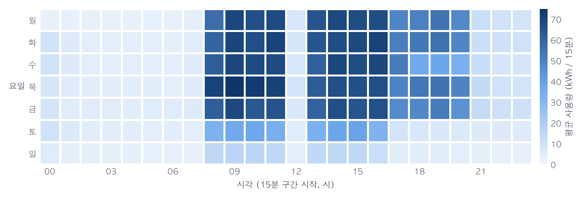

# 제철소 전력 사용 분석 (2018)

철강 공장 한 곳의 1년치 15분 단위 전력 기록을 분석하여 전력 사용이 집중되는 시간대, 사용량 예측 가능성, 평소와 다른 날, 요금과 무효전력량의 절감 여지를 정리한 프로젝트입니다.

**[보고서 보기](https://researcherhojin.github.io/steel-energy-analysis/report.html)** · **[대시보드 보기](https://researcherhojin.github.io/steel-energy-analysis/dashboard.html)** · **[분석 노트북](notebooks/analysis.ipynb)**

<picture>
  <source media="(prefers-color-scheme: dark)" srcset="docs/images/hour-weekday-dark.png">
  
</picture>

*요일·시각별 평균 전력 사용량. 평일 주간에 사용이 집중되며, 점심시간(12시)과 야간, 주말에는 크게 줄어듭니다.*

## 핵심 결과

| 질문 | 결과 | 근거 |
|---|---|---|
| 언제 많이 쓰는가 | 평일 08–18시는 1년 시간의 30%이지만, 연간 사용량의 **64%**(약 3분의 2)가 이 시간대에 쓰입니다. | 보고서 2장 |
| 예측할 수 있는가 | 15분 뒤 사용량을 평균 **3.94 kWh** 오차(오차율 16%)로 예측합니다. 직전 15분 값을 그대로 쓰는 방식보다 오차가 24% 작습니다. | 보고서 4장 |
| 부하 구분이란 무엇인가 | 원본의 `Load_Type` 열은 실측 부하가 아니라 **계절별 요금 시간표**입니다. 평일·주말 구분과 시각·계절만으로 0.88, 과거 사용량까지 쓰면 0.96의 macro-F1로 재현됩니다. | 보고서 3장, 부록 C |
| 평소와 다른 날은 언제인가 | 평일 공휴일 15일 중 **7일**, 공휴일이 아닌 평일 **5일**이 휴무였으며, 이상 판정은 **2일**입니다. 대부분 달력 일정과 일치하나, 사유는 운영 기록으로 확인해야 합니다. | 보고서 5장 |
| 어디서 줄일 수 있는가 | 역률을 0.95까지 보상하면 무효전력량이 **39%** 감소합니다. 최대부하 시간대 사용량 10%를 경부하 시간대로 옮기면 연 **481만 원**(가정 요금 기준)이 절감됩니다. | 보고서 6장 |

<details>
<summary>용어 설명</summary>

| 용어 | 뜻 |
|---|---|
| 오차율 | 15분 단위 예측 오차의 절댓값 합 ÷ 실제 사용량 합 (WAPE) |
| macro-F1 | 경부하·중간부하·최대부하별 F1 점수의 평균. 1이 만점 |
| 역률 | 공급된 전력 중 실제 일을 한 전력의 비율. 1에 가까울수록 좋음 |
| 무효전력량 (kVarh) | 전동기·변압기가 자기장을 만드는 데 쓰는 전력량. 일은 하지 않지만 설비 용량을 차지함 |

</details>

## 해석상 유의사항

| 항목 | 내용 |
|---|---|
| 금액은 가정값 | 데이터에 요금 정보가 없어, 산업용 계시별 요금을 단순화한 예시 단가(`config.TARIFF_ASSUMPTIONS`)를 적용했습니다. 금액의 크기보다 방향을 참고하십시오. |
| 분류 점수의 성격 | 11–12월 평가 결과를 본 뒤 모델을 수정했으므로 그 점수는 탐색적 결과입니다. 위 표의 부하 구분 점수는 별도의 역방향 분할(3–12월 학습, 1–2월 평가)에서 산출했습니다. |
| 원인 해석의 한계 | 단일 공장의 1년치 계량 기록이며 생산량·공정·설비 정보가 없습니다. 사용량 변화나 휴무의 원인은 추정에 그칩니다. |
| 이상 판정의 용도 | 판정 기준을 1년 전체 자료로 정했으므로 사후 점검용이며, 실시간 경보로는 쓸 수 없습니다. |

## 결과물

| 결과물 | 대상 독자 | 오프라인 사본 |
|---|---|---|
| 보고서 | 결론과 근거를 확인하려는 공장·에너지 관리자 | [PDF](<outputs/v2/제철소 전력 분석 보고서.pdf>) |
| 대시보드 | 월·시간대·요금 구간별 수치를 직접 탐색하려는 사용자 | [PDF](<outputs/v2/제철소 전력 2018 대시보드.pdf>) |
| 분석 노트북 | 분석 과정과 판단 근거를 검토하려는 분석가 | 저장소에 실행 결과 포함 |

- 보고서와 대시보드 웹 페이지는 `main` 브랜치에 변경이 올라올 때마다 GitHub Actions가 원본 CSV에서 다시 계산해 GitHub Pages에 배포합니다.
- 세 결과물의 수치는 모두 같은 분석 결과 파일(`outputs/analysis.json`)에서 나오므로 서로 일치합니다.
- PDF는 특정 시점의 정적 사본이며, 대시보드의 탭과 필터는 웹 페이지에서만 사용할 수 있습니다.

## 실행 방법

[uv](https://docs.astral.sh/uv/)만 설치하면 됩니다. Python 3.12는 uv가 자동으로 내려받습니다.

| 운영체제 | uv 설치 명령 |
|---|---|
| macOS · Linux | `curl -LsSf https://astral.sh/uv/install.sh \| sh` |
| Windows (PowerShell) | `powershell -ExecutionPolicy ByPass -c "irm https://astral.sh/uv/install.ps1 \| iex"` |

**1. 내려받기와 설치**

```bash
git clone https://github.com/researcherhojin/steel-energy-analysis.git
cd steel-energy-analysis
uv sync
```

**2. 테스트 (1–3분)**

```bash
uv run pytest
```

**3. 분석과 결과물 생성**

```bash
uv run python -m steelenergy.pipeline
uv run python web/build.py
uv run python notebooks/build_notebook.py
uv run jupyter nbconvert --to notebook --execute --inplace notebooks/analysis.ipynb
```

차례로 분석(→ `outputs/analysis.json`), 보고서·대시보드 생성(→ `build/*.html`), 노트북 생성과 실행입니다. 명령은 모든 운영체제에서 같습니다.

지원 환경은 Windows 10·11(x86 64비트, ARM64), macOS(Apple Silicon, Intel), Linux(x86_64, ARM64)이며 32비트 Windows는 지원하지 않습니다. 단계별 설명과 문제 해결은 [WORKFLOW.md](WORKFLOW.md)에 있습니다.

## 데이터

| 항목 | 내용 |
|---|---|
| 출처 | V E, S., Shin, C., & Cho, Y. (2021). *Steel Industry Energy Consumption* [Dataset]. UCI Machine Learning Repository. https://doi.org/10.24432/C52G8C |
| 관련 논문 | Sathishkumar V E, Shin C., Cho Y. (2021). Efficient energy consumption prediction model for a data analytic-enabled industry building in a smart city. *Building Research & Information*, 49(1), 127–143. |
| 파일 | `Steel_industry_data.csv`(35,040행), 원본 압축 파일 `steel+industry+energy+consumption.zip` (내용 동일) |

원본의 날짜는 일/월/연 순서이며, 매일 마지막 기록(24:00)이 같은 날짜의 00:00으로 찍혀 있습니다. 분석 코드(`src/steelenergy/io.py`)가 둘 다 보정합니다.

## 저장소 구조

```
src/steelenergy/   분석 코드 (모든 계산 함수)
notebooks/         분석 노트북과 노트북 생성기
web/               보고서·대시보드 템플릿, 빌드·배포 스크립트
tools/             README 그림 생성, 설치 환경 점검
docs/images/       README 그림
tests/             테스트
build/             생성된 웹 페이지 (git 관리 대상 아님)
outputs/           analysis.json(실행 시 생성)과 보관용 PDF(v1/, v2/)
```

상세 구조와 각 파일의 역할은 [WORKFLOW.md 9장](WORKFLOW.md#9-폴더-구조)에 있습니다. Claude Code용 작업 규칙(영어)은 [CLAUDE.md](CLAUDE.md)에 있습니다.

## 라이선스

- **코드와 문서:** [MIT License](LICENSE)
- **데이터:** 원 저작자의 CC BY 4.0을 따르며, 재사용 시 [데이터](#데이터) 절의 출처를 표기해야 합니다.
