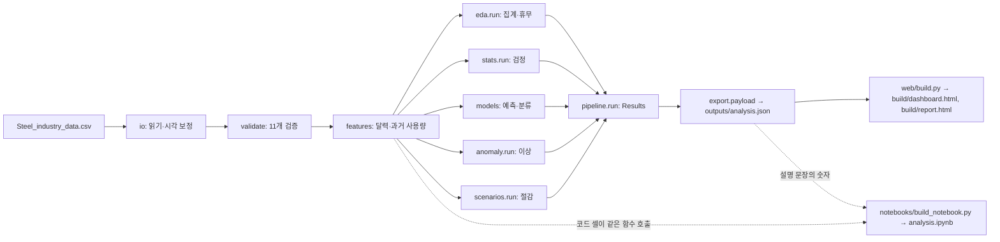

# 작업 흐름: 처음부터 따라 하기

이 문서는 이 저장소를 처음 받은 사람이 분석 결과를 처음부터 다시 만들 수 있도록 순서대로 설명합니다. 결과를 수정하는 방법과 각 단계가 정상인지 확인하는 방법도 함께 다룹니다. 무엇을 분석했고 결과가 무엇인지는 [README.md](README.md)에 먼저 정리되어 있습니다.

**목차**
1. [이 저장소가 만드는 것](#1-이-저장소가-만드는-것)
2. [준비물](#2-준비물)
3. [빠른 시작: 명령 다섯 개](#3-빠른-시작-명령-다섯-개)
4. [전체 흐름](#4-전체-흐름)
5. [분석 과정 단계별 설명](#5-분석-과정-단계별-설명)
6. [무언가를 바꾸고 싶을 때](#6-무언가를-바꾸고-싶을-때)
7. [검증 체크리스트](#7-검증-체크리스트)
8. [자주 막히는 곳](#8-자주-막히는-곳)
9. [폴더 구조](#9-폴더-구조)

Windows, macOS, Linux에서 모두 같은 명령으로 실행합니다. 운영체제마다 다른 부분(uv 설치, 경로 형식, 한글 글꼴)은 2장에 따로 적었습니다.

명령은 모두 저장소 최상위 폴더(`steel-energy-analysis/`)에서 실행합니다. 경로에 공백이나 한글이 들어 있을 수 있으므로 `cd` 할 때는 경로를 따옴표로 감싸는 편이 안전합니다.

```bash
cd "/Users/이름/Desktop/steel-energy-analysis"    # macOS · Linux (bash, zsh)
```

```powershell
cd "C:\Users\이름\Desktop\steel-energy-analysis" # Windows (PowerShell, cmd)
```

---

## 1. 이 저장소가 만드는 것

보고서(`build/report.html`), 대시보드(`build/dashboard.html`), 분석 노트북(`notebooks/analysis.ipynb`) 세 가지입니다. 각각 누구를 위한 것인지는 README의 '결과물' 표에 있습니다.

세 결과물의 숫자는 모두 같은 분석 결과 파일(`outputs/analysis.json`)에서 나옵니다. 분석 코드를 고치고 다시 실행하면 세 결과물이 함께 바뀝니다.

---|---|---|
| 분석 노트북 | `notebooks/analysis.ipynb` | 분석 과정을 따라가려는 분석가 |
| 대시보드 | `build/dashboard.html` | 수치를 직접 살펴보려는 사람(탭·필터·슬라이더) |
| 보고서 | `build/report.html` | 결론과 근거만 필요한 관리자 |

세 결과물의 숫자는 모두 같은 분석 결과 파일(`outputs/analysis.json`)에서 나옵니다. 그래서 분석 코드를 한 번 고치고 다시 실행하면 세 결과물이 함께 바뀝니다.

---

## 2. 준비물

### 2.1 지원 환경

| 운영체제 | CPU | 지원 |
|---|---|---|
| Windows 10·11 | 64비트 x86(Intel·AMD) | 지원 |
| Windows 11 | ARM64(Snapdragon 등) | 지원 |
| macOS | Apple Silicon(M1 이후) | 지원 |
| macOS | Intel | 지원 |
| Linux(glibc 2.28 이상) | x86_64(Intel·AMD), ARM64 | 지원 |
| Windows | 32비트 x86 | **지원하지 않음** |

'지원'은 필요한 패키지를 모두 미리 빌드된 형태(wheel)로 받을 수 있어 컴파일러 없이 설치된다는 뜻입니다. 이 표는 `uv run python tools/check_platforms.py`로 언제든 다시 확인할 수 있습니다. 이 스크립트는 아무것도 설치하지 않고, 각 환경에서 설치가 가능한지만 계산합니다.

32비트 Windows는 pandas, scipy, scikit-learn, matplotlib가 32비트용 배포를 중단해서 지원할 수 없습니다. Windows 11에는 32비트판이 없고, Windows 10에서도 64비트판이면 그대로 지원 환경입니다. 내 Windows가 몇 비트인지는 '설정 → 시스템 → 정보 → 시스템 종류'에서 확인합니다.

### 2.2 uv 설치

[uv](https://docs.astral.sh/uv/)는 Python 설치와 패키지 관리를 함께 해 주는 도구입니다. Python은 따로 설치하지 않아도 됩니다. 저장소에 고정된 버전(`.python-version`의 3.12)을 uv가 운영체제와 CPU에 맞게 알아서 받습니다.

macOS · Linux:

```bash
curl -LsSf https://astral.sh/uv/install.sh | sh
```

Windows(PowerShell):

```powershell
powershell -ExecutionPolicy ByPass -c "irm https://astral.sh/uv/install.ps1 | iex"
```

설치가 끝나면 터미널을 닫았다가 다시 열어야 `uv` 명령을 찾습니다. `uv --version`으로 확인하세요.

### 2.3 그 밖의 준비물

- **한글 글꼴(노트북 그래프용):** `src/steelenergy/plots.py`가 설치된 글꼴 중에서 자동으로 고릅니다.
  - **macOS:** 기본 글꼴 AppleGothic을 씁니다. 따로 할 일이 없습니다.
  - **Windows:** 기본 글꼴 맑은 고딕(Malgun Gothic)을 씁니다. 따로 할 일이 없습니다.
  - **Linux:** 나눔고딕이나 Noto CJK를 설치해야 합니다. Ubuntu·Debian 기준 명령은 `sudo apt install fonts-nanum`입니다.
  - 한글 글꼴이 하나도 없으면 경고가 나오고, 그래프의 한글이 네모로 표시됩니다.
- **웹 브라우저:** 만든 보고서·대시보드를 열어 볼 때 씁니다. 차트와 글꼴을 인터넷에서 불러오므로 인터넷 연결이 필요합니다.
- **(선택) Node.js:** 맞춤법 검사(`npx cspell`)를 돌릴 때만 필요합니다.

데이터 파일 `Steel_industry_data.csv`는 저장소에 들어 있습니다. 원본은 UCI Machine Learning Repository의 [Steel Industry Energy Consumption](https://archive.ics.uci.edu/dataset/851/steel+industry+energy+consumption)이고, 같이 들어 있는 zip 파일과 내용이 같습니다.

---

## 3. 빠른 시작: 명령 다섯 개

아래 명령은 bash·zsh(macOS·Linux)와 PowerShell·cmd(Windows)에서 똑같이 동작합니다. 셸마다 규칙이 다른 `&&`나 줄 잇기(`\`, `` ` ``)는 쓰지 않았으니 한 줄씩 차례로 실행하세요.

```bash
uv sync
uv run pytest
uv run python -m steelenergy.pipeline
uv run python web/build.py
uv run python notebooks/build_notebook.py
uv run jupyter nbconvert --to notebook --execute --inplace notebooks/analysis.ipynb
```

| 순서 | 명령 | 하는 일 |
|---|---|---|
| 1 | `uv sync` | 패키지 설치(처음 한 번, 이후에는 바뀐 것만) |
| 2 | `uv run pytest` | 테스트(1–3분) |
| 3 | `uv run python -m steelenergy.pipeline` | 분석 → `outputs/analysis.json` |
| 4 | `uv run python web/build.py` | 보고서·대시보드 → `build/report.html`, `build/dashboard.html` |
| 5 | `uv run python notebooks/build_notebook.py` 다음 `uv run jupyter nbconvert …` | 노트북 생성 후 실행 |

Windows에서도 경로는 위처럼 `/`로 써도 됩니다. Python과 uv가 그대로 알아듣습니다.

각 명령이 끝났을 때 다음 결과가 나오면 정상입니다.

| 단계 | 정상일 때 나오는 결과 |
|---|---|
| 2 | `… passed`로 끝나고 `failed`가 없음 |
| 3 | `wrote outputs/analysis.json` |
| 4 | `wrote build/dashboard.html (…KB)`, `wrote build/report.html (…KB)` |
| 5 | `wrote notebooks/analysis.ipynb`에 이어 `[NbConvertApp] Writing … bytes to notebooks/analysis.ipynb`. 확인은 `uv run python notebooks/check_notebook.py` → `error cells: 0` |

`build/dashboard.html`과 `build/report.html`은 브라우저로 바로 열 수 있습니다. 노트북은 반드시 3번(분석)을 먼저 실행한 뒤 5번으로 만드세요. 노트북 설명 문장의 숫자는 3번의 결과 파일에서 오고, 코드 셀은 같은 함수로 다시 계산하기 때문입니다.

---

## 4. 전체 흐름



코드는 역할에 따라 세 층으로 나뉩니다. 층 사이의 규칙은 `tests/test_architecture.py`의 허용표(`ALLOWED`) 한 곳에 적혀 있고, 실제 import가 이 표를 벗어나면 테스트가 실패합니다.

| 층 | 모듈 | 하는 일 | 가져다 쓸 수 있는 것 |
|---|---|---|---|
| 기반 | `config.py`, `units.py`, `labels.py` | 설정값, 전력 단위 계산(역률, kWh→kW), 화면용 한국어 이름 | `units`는 `config`만 |
| 분석 | `io.py`, `validate.py`, `features.py`, `eda.py`, `stats.py`, `anomaly.py`, `scenarios.py`, `models/` | 읽기·검증·피처·각 분석. 각 분석 모듈은 `run()` 하나로 결과 묶음을 돌려줍니다(예: `eda.run()` → `EdaResults`). | 기반 층과, 모델은 `features`·`models/split.py`까지. 분석 모듈끼리는 서로 가져다 쓰지 않습니다. |
| 조립·출력 | `pipeline.py`, `export.py`, `plots.py` | `pipeline.run()`이 각 `run()`을 순서대로 불러 `Results`를 만들고, `export.payload()`가 그것을 JSON으로 옮겨 적습니다. `plots.py`는 노트북 그래프 스타일입니다. | `export`는 `config`·`labels`만(계산하지 않음), `pipeline`은 분석 층 전체 |

웹 빌드(`web/build.py`)와 노트북 생성기(`notebooks/build_notebook.py`)는 `config`만 가져다 쓰고, 나머지는 모두 결과 파일에서 읽습니다.

- **계산은 분석 층에서만 합니다.** 웹 페이지와 `export.py`는 계산하지 않습니다. 노트북은 같은 함수를 호출해 과정을 다시 보여 주고, 설명 문장의 숫자만 JSON에서 채웁니다.
- **설정값은 `src/steelenergy/config.py` 한 곳에 모여 있습니다.** 경로, 분할 날짜, 임계값, 공휴일, 요금 가정, 모델 하이퍼파라미터, 부트스트랩 횟수가 모두 여기 있습니다.
- **화면에 보이는 한국어 이름은 `src/steelenergy/labels.py` 한 곳에 있습니다.** 모델·입력·검증 항목 이름과 특정 날짜의 해석(예: 설 연휴 전날)이 여기 있고, 세 결과물이 모두 이 파일을 씁니다.
- **웹 페이지도 나뉘어 있습니다.** 두 페이지가 함께 쓰는 색·차트는 `web/common/`, 대시보드는 탭 전환을 맡는 `web/dashboard/dashboard.js`, 공통 도구 `web/dashboard/ui.js`, 탭마다 하나씩인 `web/dashboard/tabs/*.js`로 이루어집니다.
- **노트북 생성기는 장마다 함수 하나입니다.** `notebooks/build_notebook.py`의 `CHAPTERS` 목록 순서대로 `_data`, `_eda` 같은 장 함수가 셀을 만듭니다.

---

## 5. 분석 과정 단계별 설명

일반적인 데이터 분석 순서를 따릅니다. 각 단계마다 어떤 코드가 일을 하고, 노트북의 어느 장에서 볼 수 있는지 적었습니다.

### 5.1 문제 정의 (노트북 맨 위)
분석 질문은 네 가지입니다.
1. 전력을 언제 몰아서 쓰는가?
2. 사용량을 미리 알 수 있는가?
3. 평소와 다르게 쓴 날은 언제인가?
4. 요금과 무효전력량을 줄일 여지는 어디에 있는가?

### 5.2 데이터 이해 (노트북 1장 · `io.py`)
원본에는 함정이 두 가지 있습니다.
- 날짜가 **일/월/연** 순서입니다.
- 매일 마지막 기록(24:00)이 **같은 날짜의 00:00**으로 찍혀 있습니다.

`io.fix_timestamps()`는 그 기록을 다음 날 00:00으로 옮깁니다. 그리고 구간 시작 시각을 기준으로 `operating_day`(운영일)를 만듭니다. 원본 컬럼명과 코드에서 쓰는 이름의 대응표는 노트북 1장에 있습니다.

### 5.3 정제와 검증 (노트북 2장 · `validate.py`)
11개 항목을 검사합니다. 행 수, 결측, 중복, 15분 간격, 하루 96개 기록, 요일 표기 등입니다. 하나라도 실패하면 `pipeline`이 멈춥니다.

### 5.4 탐색적 분석 (노트북 3장 · `eda.py`, `features.py`)
일·시각·요일·월별 집계, 부하 구분별 요약, 역률을 봅니다. `features.py`는 모델 입력을 만듭니다.
- **달력:** 시각, 요일, 주말 여부, 겨울 여부
- **과거 사용량:** 15분·30분·1시간·하루·일주일 전 값, 최근 1시간·24시간 평균. 모두 *t−1까지의 값만* 씁니다.

### 5.5 통계 검정 (노트북 4장 · `stats.py`)
- 15분 기록은 서로 연관되어 있으므로 하루 합계로 비교합니다.
- 결론은 효과크기와 주 단위 블록 부트스트랩 신뢰구간으로 내립니다. p값은 참고용입니다.

### 5.6 모델링 (노트북 5·6장 · `models/`)
- `models/split.py`는 시간순으로 나눕니다. 학습은 1–9월(일주일 전 값이 필요해 1/1–1/7은 제외), 검증은 10월, 테스트는 11–12월입니다. 검증으로 모델을 고른 뒤 1–10월로 다시 학습해 테스트를 한 번만 평가합니다.
- `models/regress.py`는 15분 뒤 사용량을 예측합니다. 비교용 단순 방법 세 가지(직전값, 하루 전, 일주일 전), 선형 회귀(Ridge), 부스팅 트리(HGB, scikit-learn의 HistGradientBoosting)를 견줍니다.
- `models/classify.py`는 부하 구분(`Load_Type`)을 분류합니다. 처음 시도는 실패했고, 그 원인과 수정 과정을 그대로 남겼습니다. 테스트 기간을 본 뒤 고쳤기 때문에, `reverse_check()`로 1–2월에서 따로 확인합니다.

### 5.7 휴무·이상 탐지 (노트북 7장 · `anomaly.py`, `eda.py`)
- 공휴일은 `config.KR_HOLIDAYS_2018`로 따로 판정합니다. 주말과 겹친 공휴일은 원래 쉬는 날이므로 휴무 여부를 판정하지 않습니다.
- 하루 단위로, 이전 같은 요일 4번(공휴일 제외)의 중앙값과 비교해 편차 점수를 냅니다. 점수가 ±4를 넘으면 이상입니다.
- 공휴일이 아닌 평일 휴무는 '평일 중앙값의 20% 미만'이라는 규칙으로 따로 잡습니다. 여러 날 이어진 휴무는 편차 점수로는 잘 잡히지 않기 때문입니다.
- 15분 단위 결과는 확정 이상이 아니라 점검 목록입니다.

### 5.8 절감 시나리오 (노트북 8장 · `scenarios.py`)
- **역률 보상:** 사용량은 그대로이고 무효전력량만 줄어듭니다.
- **부하 이동:** 최대부하 시간대 사용량 일부를 같은 날 경부하 시간대로 옮깁니다. 옮긴 사용량에 딸린 무효전력량도 원래 비율대로 함께 옮기므로, 하루 단위로 kWh와 kVarh가 보존됩니다.

금액은 `config.TARIFF_ASSUMPTIONS`의 **가정 단가**로 계산합니다.

### 5.9 결과 정리 (`export.py` → `web/build.py`)
- `pipeline.run()`은 분석 모듈의 `run()`을 순서대로 불러 결과 묶음(`Results`)을 만듭니다. 실행 정보(행 수, 기간, 연도)도 여기서 정리합니다.
- `export.payload()`는 그 결과를 하나의 JSON으로 옮겨 적고 표시용 이름을 붙입니다. 계산은 하지 않습니다. 키를 지우거나 이름을 바꾸면 `SCHEMA_VERSION`을 올립니다.
- `web/build.py`는 JSON을 HTML 템플릿에 넣습니다. 템플릿이 없는 값을 참조하면 빌드가 **실패**합니다(Jinja `StrictUndefined`). 숫자가 빈칸으로 조용히 나가는 일이 없습니다.
- `web/pages.py`는 `build/`의 두 페이지에 문서 머리말(doctype, 문자 인코딩, 화면 폭)을 붙이고 첫 화면(`build/site/index.html`)을 더해 `build/site/`에 씁니다. GitHub Actions(`.github/workflows/pages.yml`)가 `main`에 올라온 변경마다 테스트 → 분석 → `web/build.py` → `web/pages.py`를 실행해 GitHub Pages에 배포합니다. 같은 패키지 버전과 시드여도 모델 점수는 운영체제·CPU에 따라 끝자리가 달라질 수 있어서, README 숫자를 만든 환경과 같은 Apple Silicon macOS에서 빌드하고 테스트가 실패하면 배포하지 않습니다. `web/build.py`의 출력은 Artifact 게시용이라 머리말 없이 `<title>`로 시작합니다.
- `tools/readme_figure.py`는 같은 JSON으로 README의 요일×시각 그림(`docs/images/`, 라이트·다크 두 장)을 그립니다. 분석이 바뀌면 다시 실행해 그림도 함께 커밋합니다.
- `notebooks/build_notebook.py`도 같은 JSON을 읽어 노트북 설명 문장의 숫자를 채웁니다. 숫자 뒤의 조사(예: 0.73이다, 0.97로)는 `fix_josa()`가 맞춥니다.

결과 파일(`outputs/analysis.json`)의 주요 키는 다음과 같습니다. 템플릿을 고칠 때 참고하세요.

| 키 | 내용 |
|---|---|
| `meta` | 출처, 기간, 학습·검증·테스트 기간, 요금 가정, 임계값 |
| `validation` | 원본 검증 11개 항목의 결과 |
| `kpi` | 연간 사용량, CO₂, 역률, 집중도, 휴무·이상 일수 등 요약값 |
| `daily`, `monthly`, `profile` | 일별·월별 집계와 월×요일×시각×요금 시간대별 집계 |
| `stats` | 통계 검정(효과크기, 신뢰구간)과 배출계수 |
| `regression`, `classification` | 예측·분류 모델 점수, 예시 주간, 시각별 오차, 역방향 확인 |
| `anomaly` | 공휴일 운영, 휴무일, 이상 일자, 15분 점검 목록 |
| `scenarios` | 역률 보상·부하 이동 결과와 요금 내역 |
| `date_notes` | 특정 날짜의 해석(`labels.DATE_NOTES`) |

---

## 6. 무언가를 바꾸고 싶을 때

어떤 경우든 바꾼 뒤에는 **3장의 2–5번 명령(테스트 포함)을 다시 실행**합니다. 숫자는 손으로 고치지 않습니다.

핵심 숫자가 바뀌면 `tests/test_docs.py`가 실패하면서 README의 '핵심 결과' 절과 달라진 곳을 알려 줍니다. 그 절을 새 숫자로 고치세요. 이 테스트는 그 절의 문구를 글자 그대로 찾으므로, 문장을 다듬을 때도 테스트의 `expected` 목록을 함께 고쳐야 합니다.

| 하고 싶은 일 | 고칠 곳 |
|---|---|
| 실제 요금표로 다시 계산 | `src/steelenergy/config.py`의 `TARIFF_ASSUMPTIONS` |
| 목표 역률·휴무 기준·이상 임계값 변경 | `config.py`의 `PF_TARGET`, `SHUTDOWN_RATIO`, `ANOMALY_Z_DAY`, `ANOMALY_Z_INTERVAL`, `NEAR_THRESHOLD_Z` |
| 보고서·README가 예로 드는 부하 이동 비율 | `config.py`의 `SHIFT_EXAMPLE` |
| 모델 설정(하이퍼파라미터, 부트스트랩·순열 반복 횟수) | `config.py`의 `HGB_CLASSIFIER`, `HGB_REGRESSOR`, `LOGISTIC`, `RIDGE_ALPHA`, `BOOTSTRAP_DRAWS`, `PERMUTATION_REPEATS` |
| 페이지에 싣는 목록 길이 | `config.py`의 `TOP_EPISODES`(15분 점검 목록), `TOP_FEATURES`(중요도) |
| 다른 해의 데이터로 분석 | `config.py`의 `RAW_CSV`, `EXPECTED_ROWS`(윤년이면 366일), `KR_HOLIDAYS_2018`(그해 공휴일로 교체), `TRAIN_END`, `VALID_END`, `FORECAST_WEEK`, `WINTER_MONTHS`(요금 시간표가 바뀌는 달), 그리고 `labels.py`의 `DATE_NOTES`(날짜별 해석). 화면과 노트북의 연도는 데이터에서 자동으로 읽습니다. |
| 표·차트에 보이는 이름(모델명, 입력명, 검증 항목명) | `src/steelenergy/labels.py` |
| 보고서 문장·구성 | `web/report/report.html.j2`. 숫자는 `{{ … }}`로 JSON에서 읽습니다. |
| 대시보드 문장·패널 | `web/dashboard/index.html.j2`. 탭별 동작은 `web/dashboard/tabs/`의 해당 탭 파일, 탭 전환은 `web/dashboard/dashboard.js` |
| 두 페이지가 함께 쓰는 차트 | `web/common/views.js` |
| 색·글꼴·간격 | `web/common/tokens.css`. 라이트·다크 모드 값이 함께 있습니다. |
| README 그림 | `tools/readme_figure.py`를 고친 뒤 다시 실행합니다. 색은 `web/common/tokens.css`의 순차 색(`--seq-*`)과 맞춥니다. |
| 노트북 설명 문장 | `notebooks/build_notebook.py`의 해당 장 함수(예: 휴무·이상은 `_anomaly`). 노트북 파일을 직접 고치면 다음 생성 때 덮어씁니다. |
| 새 분석 추가 | 아래 '새 분석을 추가하는 순서' 참고 |

**새 분석을 추가하는 순서**
1. 맞는 분석 모듈에 함수를 만들고, 그 모듈의 결과 묶음(예: `EdaResults`)과 `run()`에 결과를 넣습니다. 새 모듈을 만들었다면 `tests/test_architecture.py`의 `ALLOWED`에 그 모듈이 가져다 쓸 수 있는 것을 적습니다.
2. 새 모듈이면 `pipeline.Results`에 필드를 추가하고 `pipeline.run()`에서 부릅니다.
3. `export.py`의 해당 섹션 함수(예: `_anomaly`)에서 JSON 키에 옮겨 적습니다. 계산은 1번에서 끝내고, 여기서는 옮겨 적기만 합니다.
4. 템플릿과 탭 스크립트에서 그 키를 씁니다. 노트북에 보이려면 해당 장 함수에 셀을 추가합니다.
5. 계산을 확인하는 테스트를 추가합니다.

---

## 7. 검증 체크리스트

결과를 공유하기 전에 아래를 모두 확인합니다.

```bash
uv run ruff check .          # 코드 스타일 (노트북 포함)
uv run pytest                # 모든 테스트 (실패 0이어야 함)
uv run python notebooks/check_notebook.py   # 노트북 실행 오류: error cells: 0
uv run python tools/check_platforms.py      # 지원 환경 6개에서 설치 가능한지: 모두 OK
npx cspell lint --dot "**/*" # (선택, Node.js 필요) 맞춤법: Issues found: 0
```

의존성을 바꿨다면(`uv add`, `uv remove`, `uv lock`) `tools/check_platforms.py`를 꼭 다시 실행하세요. 새 패키지가 일부 운영체제나 CPU용 배포를 내지 않으면 여기서 바로 드러납니다.

맞춤법 검사 설정은 `cspell.json`에, 프로젝트 사전은 `.cspell/project-words.txt`에 있습니다. VS Code의 Code Spell Checker 확장도 같은 설정을 읽습니다. 경고가 나면 먼저 실제 오타인지 확인하고, 라이브러리 이름·단위·고유명사처럼 맞는 단어일 때만 사전의 알맞은 분류에 추가하세요.

테스트는 다음을 확인합니다.
- 자정 기록 보정과 시간 순서, 하루 96개 기록
- 요일 표기와 운영일의 일치
- 학습·검증·테스트 기간이 겹치지 않는지
- 예측 입력에 미래 값이나 CO₂, 같은 시각 측정값이 섞이지 않는지
- 부하 이동 시나리오에서 하루 사용량·무효전력량이 보존되고 요금 항목의 합이 합계와 맞는지
- 공휴일이 이상으로 판정되지 않는지
- JSON 형식, 템플릿 렌더링, 노트북 설명 문장이 결과 파일에서 만들어지는지, 숫자 뒤 조사
- 모듈이 자기 층에서 허용된 것만 가져다 쓰는지, 웹 빌드와 노트북 생성기가 `config` 외의 분석 모듈을 쓰지 않는지(`tests/test_architecture.py`)
- 문서(`README.md`, `WORKFLOW.md`, `CLAUDE.md`)가 가리키는 파일과 설정 이름이 실제로 있는지, README의 핵심 결과 숫자가 분석 결과와 같은지, 굵게 표시와 목차 링크가 제대로 렌더링되는지(`tests/test_docs.py`)

노트북은 실행 후 오류가 난 셀이 없어야 합니다. `uv run python notebooks/check_notebook.py`가 `error cells: 0`을 출력하고, 오류가 있으면 종료 코드 1로 끝납니다.

화면은 브라우저에서 직접 확인합니다.
- 라이트·다크 모드
- 폭을 좁힌 모바일 화면
- 차트 축 제목과 범례가 겹치지 않는지
- 보고서 숫자가 대시보드와 같은지

---

## 8. 자주 막히는 곳

| 증상 | 원인과 해결 |
|---|---|
| `ModuleNotFoundError: No module named 'steelenergy'` | `uv sync` 뒤에도 패키지를 못 찾는 경우입니다. `uv sync --reinstall-package steelenergy`를 실행하세요. |
| Windows: `uv`를 찾을 수 없다(`'uv' is not recognized…`) | 설치 직후에는 터미널을 새로 열어야 경로가 반영됩니다. 그래도 안 되면 `%USERPROFILE%\.local\bin`이 PATH에 있는지 확인하세요. |
| Windows: uv 설치 스크립트가 실행 정책 때문에 막힘 | 2.2의 명령처럼 `-ExecutionPolicy ByPass`를 붙여 실행합니다. 시스템 설정은 바꾸지 않습니다. |
| Windows PowerShell 5.1에서 `&&`가 오류 | 구버전 PowerShell은 `&&`를 지원하지 않습니다. 이 문서의 명령은 한 줄에 하나씩 쓰여 있으니 그대로 차례로 실행하세요. |
| Windows 32비트에서 `uv sync`가 패키지를 못 찾음 | 2.1에 적은 대로 32비트 Windows는 지원하지 않습니다. 64비트 Windows에서 실행하세요. |
| Windows ARM64에서 설치가 느림 | 처음 한 번은 ARM64용 Python과 패키지를 받느라 시간이 걸립니다. 컴파일은 하지 않습니다. |
| `cd: no such file or directory` | 경로에 공백이나 특수 문자가 있으면 생깁니다. 경로를 따옴표로 감싸세요. |
| 빌드 중 `jinja2.exceptions.UndefinedError` | 템플릿이 JSON에 없는 키를 읽은 것입니다. `pipeline`을 다시 실행했는지 확인하고, 새 키라면 `export.py`에 추가합니다. |
| 노트북 그래프의 한글이 네모로 나옴 | 한글 글꼴이 없다는 경고가 함께 나옵니다. 2.3의 안내대로 글꼴을 설치하세요(Linux는 `sudo apt install fonts-nanum`). 설치한 뒤에도 그대로면 matplotlib 글꼴 캐시를 지우고 다시 실행합니다(macOS·Linux `~/.cache/matplotlib`, Windows `%USERPROFILE%\.matplotlib`). 다른 글꼴을 쓰려면 `src/steelenergy/plots.py`의 `KOREAN_FONTS`에 이름을 추가하세요. |
| git으로 받은 뒤 줄바꿈 때문에 파일이 모두 바뀐 것으로 보임 | `.gitattributes`가 텍스트 파일의 줄바꿈을 LF로 고정합니다. 이 파일이 생기기 전에 받은 저장소라면 `git add --renormalize .`를 한 번 실행하세요. |
| HTML에서 차트가 안 보임 | 오프라인이거나 CDN 주소가 바뀐 경우입니다. 템플릿의 ECharts 주소(`cdnjs.cloudflare.com/ajax/libs/echarts/5.6.0/…`)가 열리는지 확인하세요. |
| 날짜가 하루씩 밀려 보임 | 원본 시각은 구간이 *끝나는* 시각입니다. 집계는 `operating_day`(구간 시작 기준)로 해야 합니다. |

---

## 9. 폴더 구조

```
steel-energy-analysis/
├── README.md                     무엇을 분석했고 결과가 무엇인지
├── WORKFLOW.md                   이 문서: 처음부터 따라 하기
├── CLAUDE.md                     Claude Code용 작업 규칙(영어)
├── Steel_industry_data.csv       원본 데이터
├── steel+industry+energy+consumption.zip   원본 압축 파일(내용 동일)
├── .gitattributes                운영체제가 달라도 줄바꿈을 같게 유지
├── pyproject.toml, uv.lock       의존성 고정(모든 지원 환경용으로 한 번에 잠김)
├── cspell.json, .cspell/         맞춤법 검사 설정과 프로젝트 사전
├── src/steelenergy/              분석 코드 (로직은 여기에만)
│   ├── config.py                 경로·임계값·공휴일·요금 가정·모델 설정
│   ├── units.py                  역률, kWh→kW 같은 전력 단위 계산
│   ├── io.py, validate.py        읽기·시각 보정·검증
│   ├── features.py, eda.py       피처·집계
│   ├── stats.py                  통계 검정
│   ├── models/                   split, regress, classify
│   ├── anomaly.py, scenarios.py  휴무·이상, 절감 시나리오
│   ├── labels.py                 화면에 보이는 한국어 이름
│   ├── pipeline.py               각 모듈의 run()을 조립해 Results 생성
│   ├── export.py                 Results → JSON (계산하지 않음)
│   └── plots.py                  노트북 그래프 스타일
├── notebooks/
│   ├── build_notebook.py         노트북 생성기 (장마다 함수 하나, 숫자는 결과 파일에서)
│   ├── check_notebook.py         노트북에 실행 오류가 남아 있는지 확인
│   └── analysis.ipynb            생성·실행된 노트북
├── web/
│   ├── common/                   공통 색·글꼴(tokens.css), 차트(charts.js, views.js)
│   ├── dashboard/                템플릿, 스타일, dashboard.js(탭 전환), ui.js(공통 도구), tabs/(탭별 동작)
│   ├── report/                   보고서 템플릿·스타일·스크립트
│   ├── build.py                  JSON → HTML
│   └── pages.py                  HTML → GitHub Pages용 완전한 문서(build/site/)
├── tools/
│   ├── check_platforms.py        지원 환경별 설치 가능 여부 확인(아무것도 설치하지 않음)
│   └── readme_figure.py          README 그림 생성 → docs/images/
├── docs/images/                  README 그림(라이트·다크)
├── .github/workflows/pages.yml   GitHub Pages 자동 배포
├── tests/                        pytest (test_architecture.py: 모듈 경계, test_docs.py: 문서)
├── outputs/
│   ├── analysis.json  (생성물)   분석 결과
│   └── v1/, v2/                  직접 저장해 둔 이전 판 PDF (다시 만들 수 없음)
└── build/    (생성물)            dashboard.html, report.html, site/(배포용)
```

`build/`와 `outputs/analysis.json`은 언제든 다시 만들 수 있어서 git에 넣지 않습니다(`.gitignore`). `outputs/v1/`, `outputs/v2/`의 PDF는 어떤 명령도 만들지 않으므로 지우지 마세요.
